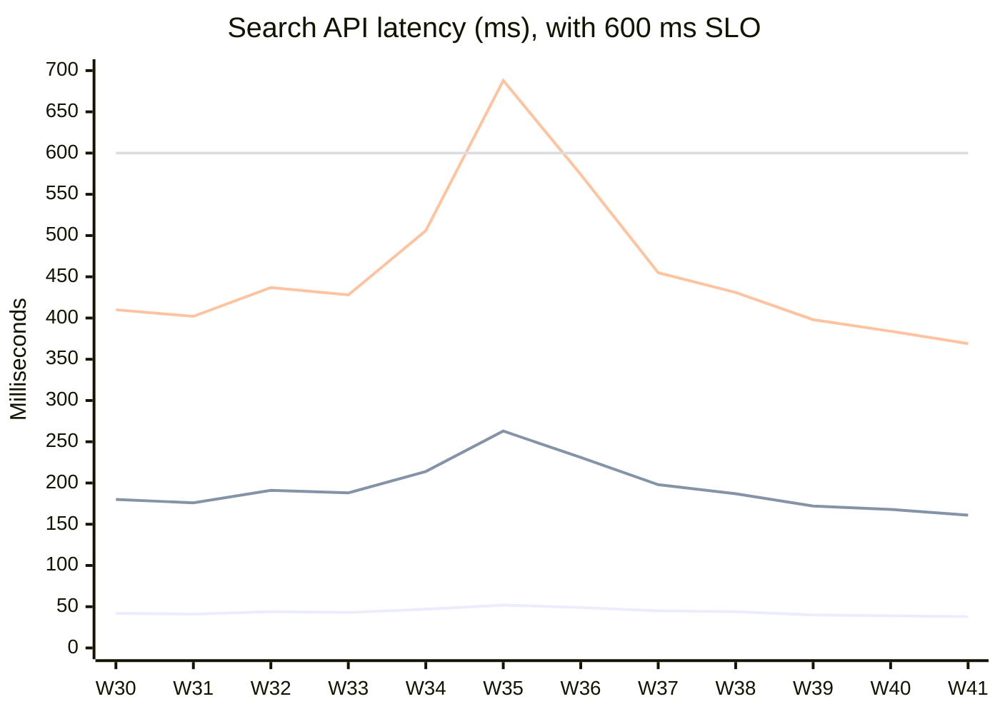

# Search API Latency Report, W30 to W41 2026

**Fieldnote Maps · Search team · All latencies in milliseconds**

## Latest week (W41)

| p50 | p95 | p99 | SLO compliance |
|---|---|---|---|
| **38 ms** | **161 ms** | **369 ms** | **11 of 12 weeks** |

The SLO is p99 under 600 ms.

## Latency trend

From bottom to top, the lines are **p50**, **p95** and **p99**. The flat line at 600 ms is the **SLO** threshold for p99.

## Weekly data

| Week | p50 | p95 | p99 |
|---|---|---|---|
| W30 | 42 | 180 | 410 |
| W31 | 41 | 176 | 402 |
| W32 | 44 | 191 | 437 |
| W33 | 43 | 188 | 428 |
| W34 | 47 | 214 | 506 |
| W35 | 52 | 263 | **688** |
| W36 | 49 | 231 | 574 |
| W37 | 45 | 198 | 455 |
| W38 | 44 | 187 | 431 |
| W39 | 40 | 172 | 398 |
| W40 | 39 | 168 | 384 |
| W41 | 38 | 161 | 369 |

## What changed

Latency spiked in W35, after the search index migrated to the new cluster, with p99 reaching 688 ms. It recovered once query caching shipped in W37. Since then all three percentiles have kept falling, and W41 is the best week in the period on p50, p95 and p99.

> **SLO breach:** W35 is the only week that breached the SLO, with p99 at 688 ms against the 600 ms limit.
