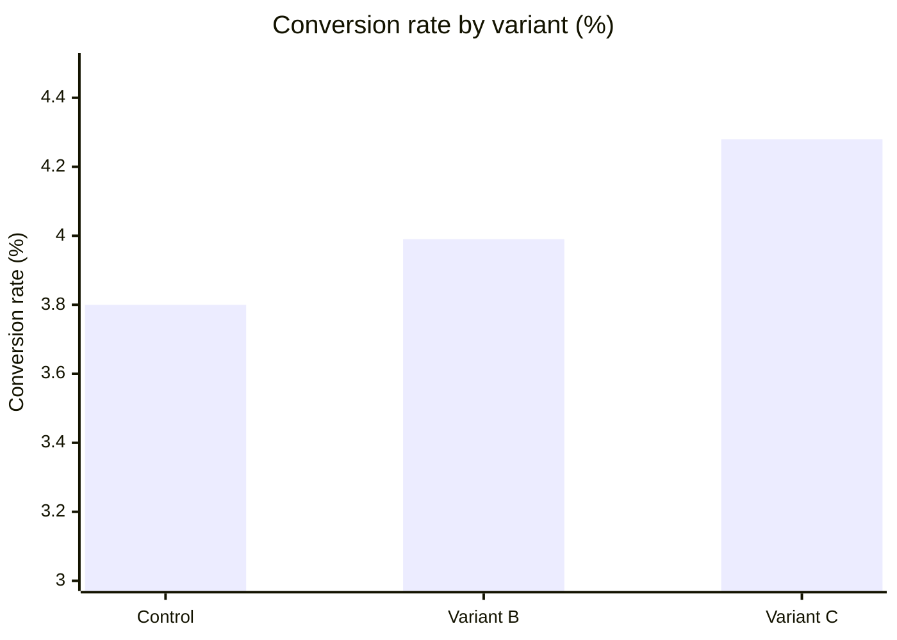
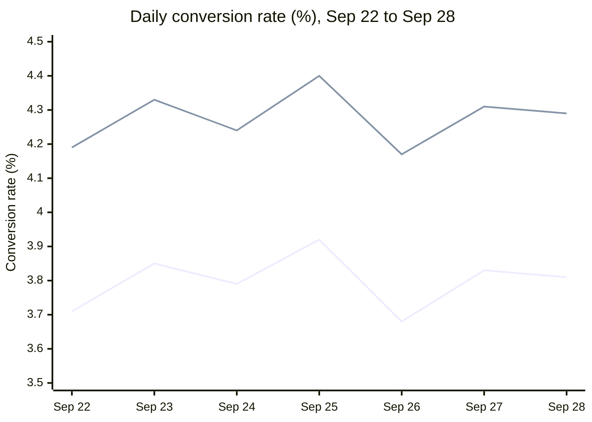

# EXP-418: Checkout Button Copy

**Marigold Home · Growth Analytics · Ran 2026-09-08 to 2026-09-28**

We tested three labels for the checkout button:

- **Control:** "Place order"
- **Variant B:** "Complete purchase"
- **Variant C:** "Pay securely now"

| Total visitors | Winner | Lift | Confidence |
|---|---|---|---|
| **144,607** | **Variant C** | **+12.6%** | **99.7%** |

## Results

| Variant | Visitors | Conversions | Conversion rate | Lift vs control | p-value |
|---|---|---|---|---|---|
| Control ("Place order") | 48,210 | 1,832 | 3.80% | — | — |
| Variant B ("Complete purchase") | 48,095 | 1,919 | 3.99% | +5.0% | 0.14 |
| Variant C ("Pay securely now") | 48,302 | 2,068 | **4.28%** | **+12.6%** | **0.003** |

## Conversion rate

The axis starts at 3.0% so the differences are visible.

## Daily trend

Daily conversion rate over the final week of the test.

The upper line is **Variant C** and the lower line is **Control**. Variant C was ahead on every day of the week, by 0.45 to 0.49 percentage points.

## Decision

> **Ship Variant C ("Pay securely now") to 100% of traffic.** It lifted conversion by 12.6% at p = 0.003.

**Notes**

- Variant B's +5.0% lift was not statistically significant (p = 0.14).
- Average order value did not change: $87.40 for Variant C against $87.15 for Control. The lift comes from more orders, not smaller ones.
